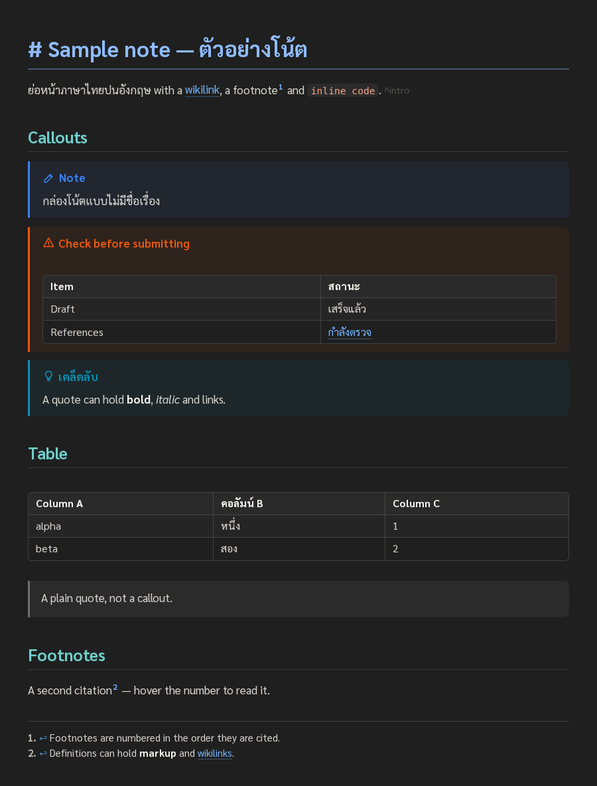

# Live Writer

*Formerly md-live-preview-plus.* Write Markdown, LaTeX and Quarto in their rendered form, with your citations, your Zotero library and Claude beside you.

Live Writer is developed on its own. It began in October 2026 as a fork of
[Markdown Live Preview Editor](https://github.com/t-shoot/md-live-preview-editor) by t-shoot
(MIT), whose editor core it still builds on: editing in the rendered preview, Mermaid and
draw.io diagrams, editable tables, CSS themes. It no longer follows that project, and it is
affiliated with neither t-shoot nor Obsidian.

What Live Writer adds:

- **Wikilinks**: `[[note]]`, `[[note#Heading]]` and `[[note#^block-id|label]]` render as links.
  - A click opens the note in Live Preview at the heading or block.
  - Notes are found by name anywhere in the workspace, as in Obsidian.
  - Links work in table cells, with `\|` or a bare `|` before the label.
  - **Hover** over a link to read its target in a card: a heading's section, or a block. The title of the card opens the note.
  - A link to a note that does not exist is shown faint.
- **Backlinks**: a sidebar view lists the notes that link to the one you are reading, each with the line that does it. A draft citing `[@key]` counts as a link to `@key.md`.
- **Pandoc citations** `[@key]`: each key links to its `@key` reference note, with hover and click as for wikilinks. A key with no note is drawn faint.
- **A right-click menu** that offers what fits the spot:
  - copy a block link (adds the `^id` for you), copy as rich text for Word, add a REVIEW comment, ask Claude about the selection;
  - search Google or Google Scholar for the selection;
  - open a link to the side, copy a formula's TeX;
  - insert, delete and sort table rows and columns, copy a table for Excel;
  - renumber footnotes.
- **Completion**:
  - `[[` offers the notes in the workspace.
  - `[[note#` offers that note's headings, and `[[note#^` its block ids.
  - `[^` offers the existing footnotes, plus *new footnote*.
- **Callouts**: `> [!note]`, `> [!warning] Title` and the other Obsidian types render as coloured cards with an icon.
  - `> [!type]-` starts folded and `> [!type]+` starts open. The chevron after the title folds or opens either.
- **Tables inside quotes and callouts** render as tables, even when the table follows a line of text directly.
- **Footnotes**: `[^1]` renders as a superscript number numbered by first citation.
  - Hover over the number to read the note. Click it to jump to the definition, and click `↩` to jump back.
  - **Insert Footnote** (`Ctrl+Alt+6`, or `Cmd+Alt+6` on macOS) adds the next number at the cursor and its definition at the end of the file.
- **Block ids** (`… ^ma-32`) are dimmed rather than shown at full strength.
- **HTML comments** (`<!-- … -->`) are tinted as notes to the writer.
- **Image embeds** `![[name.png]]` (and `|300` for width): the file is found by name anywhere in the workspace.
- **Underline** with Ctrl/Cmd+U, written as `<u>…</u>`.
- **Math**: `$…$` and `$$…$$` render with KaTeX, in the text, in tables and in previews. Click a formula to edit its TeX.
- **LaTeX Live Preview**: a `.tex` file opens in the same editor and is drawn as Overleaf's Visual Editor draws it, with the source back wherever the caret is.
  - Headings, text styles, KaTeX math (with the document's macros), lists, `abstract`, figures, captions, `tabular` (booktabs rules, `\multicolumn`), images, footnotes, links and LaTeX typography (`~`, `--`, ``` `` ```…`''`) are drawn. The preamble folds into one line.
  - `\ref`, `\eqref`, `\cite`, captions and equation numbers show **the numbers of your last build**, read from the root's `.aux`, and follow every rebuild. Hover a citation to read its `.bib` entry.
  - The root is found by `% !TEX root`, `\documentclass`, or the file that `\input`s this one; `\input{…}` opens the file in the Live Preview. PDF figures show their first page when `pdftoppm` is installed.
  - **Build** (▶ in the title bar, Ctrl+Alt+B), **Build with Recipe…** (Ctrl+Alt+Shift+B: xelatex, pdflatex, latexmk … from LaTeX Workshop's recipes) and **View PDF** (Ctrl+Alt+V), all through LaTeX Workshop.
  - **Show in PDF** (Ctrl+Alt+J or right-click): LaTeX Workshop's viewer jumps to the line under the caret, by SyncTeX. Back the other way, Ctrl+click in the viewer shows the line in Live Writer (`liveWriter.plus.inverseSearch`).
  - **TikZ pictures** (`tikzpicture`, `tikzcd`, `pgfpicture`, `circuitikz`, pgfplots inside them) show as your last build drew them: SyncTeX finds the picture in the PDF and `pdftoppm` cuts it out. The code comes back while the caret is in it. A picture no current build has drawn is compiled on its own (standalone class plus the root preamble's packages and macros; pdflatex, or xelatex with fontspec; `liveWriter.plus.tikzCompile`), and *last build* marks an older drawing kept when that fails. Needs `pdftoppm`; pictures from the build also need SyncTeX (LaTeX Workshop's default) and the `synctex` command.
  - Ctrl/Cmd+B / +I wrap in `\textbf` / `\textit`, Ctrl/Cmd+/ comments lines, Enter continues an `\item`; completion after `\ref{`, `\cite{` and `\begin{`.
  - Nothing is compiled. Keep building with LaTeX Workshop (or latexmk) for the PDF.

- **Quarto `.qmd` files** open in Live Writer and look like the rendered book:
  - `::: {.callout-note}` … `:::` is a callout box, titled by its first heading, `title="…"` or its type. `icon=false` and `appearance="simple"`/`"minimal"` are followed.
  - `{#fig-id width=80%}` is a figure, sized and captioned, numbered per file as Quarto numbers a chapter.
  - `@fig-id` reads *Figure 2* and `@sec-id` the heading's text; a click jumps there. The words come from the project's `_quarto.yml` (`crossref-fig-title`, `callout-note-title`, …).
  - `[@chen2015]` reads *(Chen, 2015)* and `@chen2015` *Chen (2015)*, from the `.bib` that `bibliography:` names, in the `csl:` style (APA or Chicago author-date) and the `lang:` of the project. Hover for the entry. A presentation (`format: revealjs`, `beamer`, `pptx`) shows as numbered slide cards, with its title slide, coloured section slides, pauses and speaker notes; `::: {.columns}` sits side by side (`</>` for the source). `::: {#refs}` shows the reference list in APA: every entry with `nocite: '@*'`, else those cited plus the `nocite:` names.
  - `{#sec-id}` after a heading is hidden, and callout titles stay out of the Outline.
  - A heading or image that Pandoc joins to the line above or below it is flagged. Quarto would print the heading as `## …` and leave the figure unnumbered.
- **Rewrite with Claude (or with a command of your own, `liveWriter.plus.rewriteCommands`)** (right-click on a selection): *Paraphrase*, *Tighten*, *More Formal*, *Translate to English*, *Translate to Thai*. Meaning, terms, numbers, citations and markup are kept; replace the passage or copy the result from the card. The model is `liveWriter.plus.claudeModel`. Needs Claude Code signed in (`claude -p` is run without tools or your settings).
- **Font:** the setting `liveWriter.plus.fontFamily` (e.g. `Sarabun, sans-serif`) sets the text font; code and formulas keep theirs.
- **Fold sections and follow the Outline:** a chevron beside each heading folds its section; the Outline view marks the heading the caret is under.
- **Insert Citation from Zotero** (Ctrl+Alt+C): pick works in Zotero's citation picker; they go in at the caret as `[@key]` or `\cite{key}`. Needs Better BibTeX.
- **Citations open their paper in Zotero.** Rest the pointer on a citation (`[@key]` in a note or a `.qmd`, `\cite{key}` in LaTeX) for its entry with *Open PDF* (in Zotero's reader, with your annotations) and *Show in Zotero*; or right-click → *Open PDF in Zotero*.
  - The key is looked up in the running Zotero (its local API, enabled under *Settings → Advanced → Allow other applications on this computer to communicate with Zotero*, or Better BibTeX). When Zotero is closed, the `zotero_key` / `pdf_key` in a vault's `@key` note are used, and the link starts Zotero.
  - `zotero://` links need Zotero registered as their handler. On Linux with Zotero from the tarball: `xdg-mime default zotero.desktop x-scheme-handler/zotero`, with `~/.local/share/applications/zotero.desktop` linked to the `zotero.desktop` of the current Zotero folder.
- **Claude Code sees your selection**: the exact Markdown source, its line numbers and the file path. A webview's selection is otherwise invisible to VS Code and to Claude.
  - The file is saved when you select, so the line numbers match the file on disk.
  - Text selected inside a rendered table is sent as the cells' Markdown source.
  - A status bar item shows what Claude will get with your next prompt. Click it to stop sending.
  - A notice in Claude Code says what was sent.
- **A readable selection highlight**: the selection band no longer hides the text.
- **A Thai/English reading theme**: Sarabun is embedded, so no font needs installing.



**Get it from [Releases](../../releases), not from the VS Code Marketplace.** It is not
published there. Its id is
`kasemsit.live-writer` (until 0.4.17 it was `local.markdown-live-preview-editor-claude`; the
installer removes that one, and settings made under `mdLivePreview.*` carry over to `liveWriter.*`). It checks
GitHub once a day and tells you when a newer release is out.

## Install (Windows, macOS, Linux)

Download `live-writer.zip` from [Releases](../../releases), unzip it, and run the
installer from that folder:

- **Windows:** `powershell -NoProfile -ExecutionPolicy Bypass -File .\install.ps1`
- **macOS / Linux:** `./install.sh` (needs `python3`)

The installer does three things:
1. It removes earlier installs that register the same editor (Live Writer's former id, and t-shoot's Markdown Live Preview Editor), then installs the `.vsix`.
2. It copies the Claude Code hook to `~/.claude/hooks/`, or `%USERPROFILE%\.claude\hooks\` on Windows.
3. It registers the hook in Claude Code's `settings.json`, keeping your other settings. Running it twice is harmless.

Next:
1. Reload VS Code (*Developer: Reload Window*).
2. Start a new Claude Code session.
3. Open a `.md`, `.qmd` or `.tex` file: it opens in Live Writer. The ✏️ button on a text editor's title bar opens one in Live Writer; *Open With → Text Editor*, or the button on Live Writer's title bar, shows the source.

Live Writer is the default editor for `.md`, `.markdown`, `.qmd` and `.tex` from 1.7.0. The setting `liveWriter.defaultEditor` changes that: `livePreview` (the default), `prompt` (the text editor stays the default) or `default` (always the text editor). It writes `workbench.editorAssociations` in your user settings.

To check that the bridge works, select some text and ask Claude what you selected.

Only want the extension, without the Claude bridge? Install the `.vsix` on its own:
`code --install-extension live-writer-<version>.vsix`.

The reading theme `thai-readable.css` ships inside the `.vsix`. On first run it is added to
the **CSS Themes** view and switched on, unless you have already chosen another theme.
Later releases update it.

## Settings

| setting | default | what it does |
|---|---|---|
| `liveWriter.plus.shareSelectionWithClaude` | `true` | Writes the selection to `~/.claude/live-preview-selection.json`, only if `~/.claude` exists. |
| `liveWriter.plus.checkForUpdates` | `true` | Once a day, asks `api.github.com` for the latest release. |
| `liveWriter.plus.pageWidth` | `0` | Width of the reading column in em; `0` keeps the theme's. Right-click → *Wider Page* / *Narrower Page*. |

The keybinding for **Insert Footnote** can be changed in *Keyboard Shortcuts*. Search for
`liveWriter.plus.insertFootnote`.

## How the Claude bridge works

1. The webview posts the CodeMirror selection to the extension host.
2. The host saves the file if it has unsaved changes, then writes `~/.claude/live-preview-selection.json`.
3. On every prompt, the hook (`plus/hooks/`) adds that selection to Claude's context and shows a one-line notice saying what it sent.

What the hook sends:
- **A new selection** is sent in full the first time a Claude session sees it.
- **The same selection on later prompts** gets a one-line reminder of its file and lines, so the conversation does not grow with every prompt.
- **A selection over 4,000 characters** is sent as its head and tail plus its line range, which Claude can read from the file.
- **Nothing** when the selection is empty or more than 30 minutes old.

The selection stops being sent when you:
- clear it, or click the status bar item;
- select text in an ordinary editor;
- close the preview.

The selection stays on your own machine. Claude receives it only when you send a prompt.

## Building from source

```
npm ci
npm run compile          # bundles, typechecks, builds the theme
npm test                 # unit tests (vitest)
npx playwright install chromium
npm run test:e2e         # the real webview in headless Chromium
npx vsce package         # → live-writer-<version>.vsix
```

`plus/release.sh` builds, tests, tags and publishes a GitHub release with the `.vsix` and
the installer zip. `node plus/render.js note.md` renders one of your own notes headlessly
and reports what the added features produced. A `.qmd` gets its Quarto project (the
nearest `_quarto.yml` and its bibliography); add `--height 150000` for a long file, or its
end is never drawn.

## Where the code is

- `src/webview-editor/` is the editor (a CodeMirror 6 webview): `livePreviewPlugin.ts` draws Markdown, with tables, Mermaid and draw.io beside it.
  - `features/` holds one module per feature (wikilinks, callouts, footnotes, math, citations, Quarto, Zotero, rewrite, …), `cm.ts` for the helpers they share, and `hostRequests.ts`, the one channel to the extension host. `features/tex/` is the LaTeX editor.
- `src/editor/` is the extension host: `documentSync.ts` keeps the editor and the file in step; `features/` finds what the editor cannot read itself (notes, `_quarto.yml`, `.bib`, `.aux`, Zotero, TikZ crops) and runs Claude.
- `src/shared/` holds the pure logic both sides use, each module with its tests: `bib.ts` and `citations.ts` (checked against `quarto pandoc --citeproc` output in `fixtures/citeproc.json`), `quarto.ts`, `tex*.ts` (the LaTeX scanner, headings, text, macros, project files, `.aux` and `tabular`), `markdownBlocks.ts` (the block structure the link preview card and Copy as Rich Text both draw), `references.ts`, `texStandalone.ts`, `zotero.ts`, `synctex.ts`, `rewrite.ts`, `messages.ts` (every message between the two sides).
- `src/test-support/vscode.ts` is an in-memory `vscode` for the host's unit tests.
- `media/` holds the stylesheets (`writer.css` for the features); `plus/` the theme source, fonts, the Claude Code hook, installers and the release and render tools.
- `src/webview-editor/features/table.ts` replaces @lezer/markdown's GFM table parser with a copy that knows about wikilinks and quotes.

## Licence

- **The code:** MIT, see `LICENSE`. It is t-shoot's licence, kept as MIT requires for the code Live Writer still contains, with Live Writer's copyright added.
- **AWS shapes (from t-shoot's editor):** their own terms, see `THIRD-PARTY-NOTICES.md` and `LICENSE-SHAPES`.
- **KaTeX** (bundled for math, fonts included): MIT, © Khan Academy and other contributors, as its npm package states; listed in `THIRD-PARTY-NOTICES.md`.
- **Sarabun:** © 2018 The Sarabun Project Authors, SIL Open Font License 1.1, see `plus/fonts/OFL.txt`.
  - It is embedded in the theme.
  - The `.ttf` files in `plus/fonts/` are there if you want the font system-wide.
